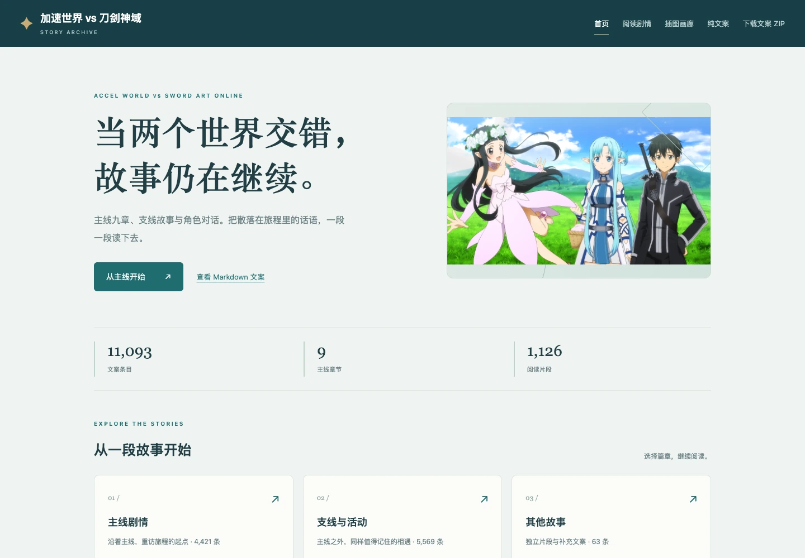
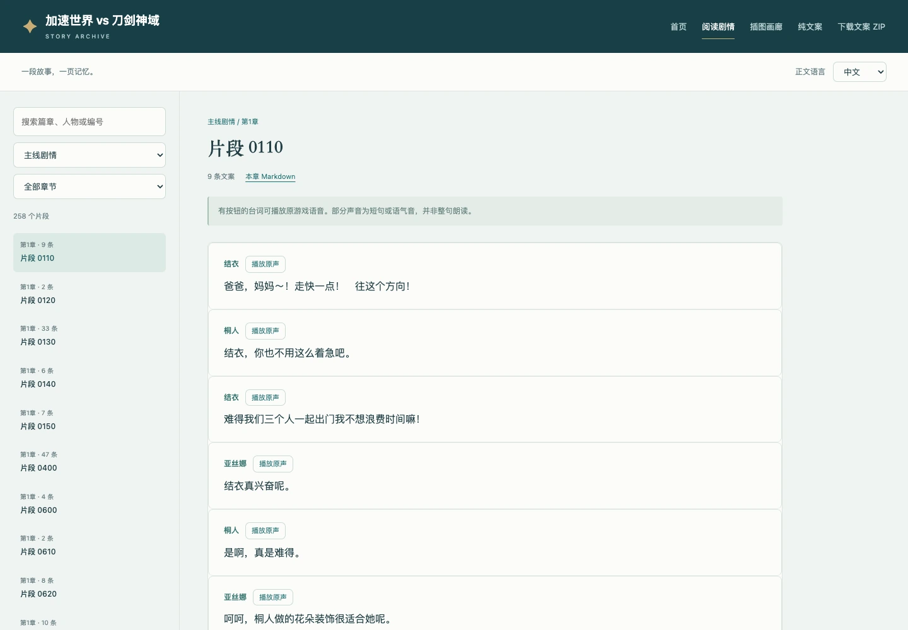
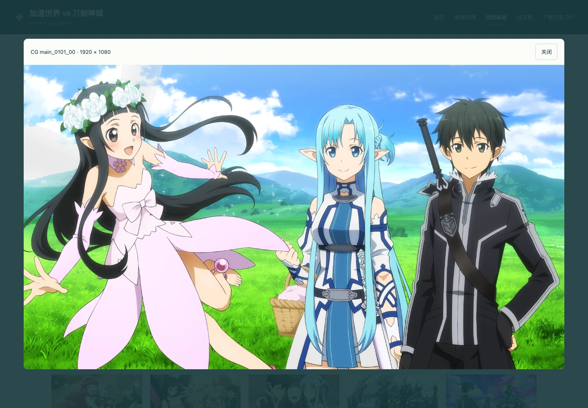

# 加速世界 vs 刀剑神域 · 剧情阅读档案

九章主线、支线故事与角色对话。可在线阅读，也可下载后离线打开，支持原声播放和图片查看。

**[打开网站](https://arceus-jia.github.io/sao-story-accel-vs-sao/) · [一键下载纯文案 ZIP](https://arceus-jia.github.io/sao-story-accel-vs-sao/downloads/sao-story-accel-vs-sao-texts.zip) · [剧情阅读](https://arceus-jia.github.io/sao-story-accel-vs-sao/剧情阅读.html)**

## 页面预览







## 收录内容

- 纯文案：中文 154 份 Markdown；下载包只含这些文档，不含图片、声音或制作数据。
- 文案来源：简体由游戏内繁体转换，网站可切换日文原文。纯文案下载仅含已有中文，不补造英文。
- 图片：45 张剧情 CG、63 张背景，按原始 1920×1080 尺寸无损保存。图片位于独立画廊，尚未恢复与具体对白的可靠对应关系。
- 语音：9,983 条文案有可确认的日语原声；7 条角色关系有歧义的 ADV 台词未配声音，其他未确认语音表关系的文案也不补配。 部分是短句或语气音，并非整句朗读；没有确认关联的台词不显示播放按钮。

范围限于本次提供的本地游戏资源，不保证覆盖游戏历史上所有版本、更新或服务器下载内容。图文是静态阅读档案，不模拟完整游戏演出。

## 使用方式

在线访问上方网站，按目录选择篇章；有播放按钮的台词可收听原声，图片可点击放大。音频按需加载，不会一次下载整站。

只看文字时，点击“下载文案 ZIP”，完整解压后阅读 `文案/中文` 或 `文案/English` 中已有的 Markdown。

离线阅读整个网站时，下载本仓库 ZIP 并完整解压，用浏览器打开 `site/index.html`，保留 `site/assets`、`site/文案` 和 `site/downloads`。不需要安装依赖或启动服务器。

## 仓库与部署

```text
site/                 网站、阅读所需资源、Markdown 与纯文案下载包
docs/screenshots/     README 中的真实页面截图
.github/workflows/   GitHub Pages 静态部署
```

向 `main` 推送后，GitHub Actions 仅将 `site/` 发布到 Pages。网站使用相对路径，无框架构建、外部字体或 CDN 依赖。修改文件后保持资源路径一致即可。

仓库采用允许清单式 `.gitignore`。原始 APK/游戏包、提取缓存、数据库、数据表、凭据和整个网站的重复打包 ZIP 均不提交。

## 同系列档案

- [SAOUB](https://arceus-jia.github.io/sao-story-saoub/)
- [零境交错](https://arceus-jia.github.io/sao-story-crossing-void/)
- [SAO Memory Defrag](https://arceus-jia.github.io/sao-story-saomd/)

## 内容归属

非官方的个人阅读整理项目，与游戏开发商、发行商无关联。游戏文字、图片和原声的权利归原权利人；本仓库没有为这些内容附加开源授权。请勿将其当作官方版本或用于商业用途。
